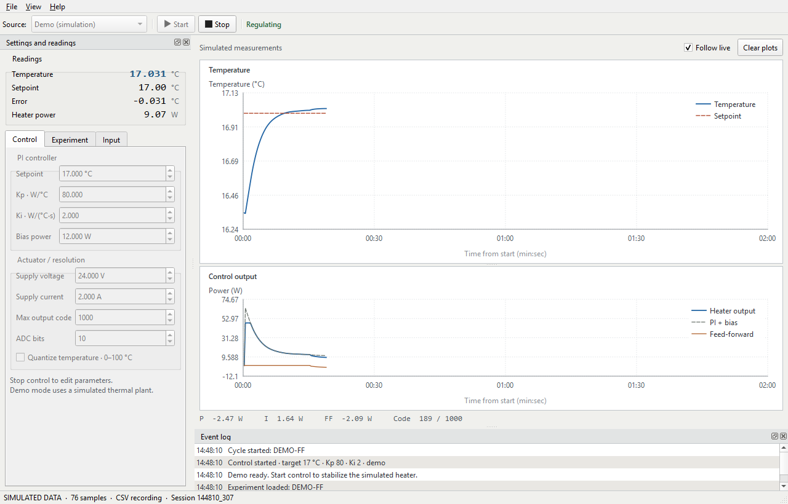

# PID Studio

**C++17 / Qt 6 · управление температурой · PI + двухканальная feed-forward компенсация**

Desktop-приложение, разработанное для регулирования температуры и проведения реальных экспериментов: PI-регулятор, компенсация возмущений, циклограммы, графики и запись измерений.

В публичной версии доступны деморежим и обработка измерений из обновляемого CSV. Интеграция с конкретной установкой, её рабочие настройки и экспериментальные данные в эту версию не входят. Все настройки по умолчанию, параметры встроенной модели, CSV-примеры и скриншот демонстрационные. Подключение к исполнительным устройствам в публичной версии отсутствует; рассчитанное управление записывается в журнал.

Используется **PI-регулятор**, без дифференциальной составляющей. Настройки демомодели: **Kp = 80 Вт/°C, Ki = 2 Вт/(°C·с)**, базовая мощность 12 Вт, демонстрационное питание 24 В / 2 А.



## Возможности

- PI-регулирование с ограничением мощности и защитой интегратора от накопления при насыщении.
- Два независимых lead-lag фильтра для feed-forward компенсации.
- Встроенная тепловая модель и два примера: `DEMO-PI` и `DEMO-FF`.
- Чтение реальных измерений из обновляемого CSV с выбором столбца температуры.
- Графики температуры, уставки, мощности и составляющих управления, прокрутка и масштабирование.
- Запуск циклограммы сразу или по расписанию, отмена и отображение диапазона изменения температуры.
- CSV-журнал измерений и событий для каждой сессии, выбор каталога через `--output-dir`.
- Собственный виджет графиков на `QPainter`; дополнительные библиотеки графиков не требуются.

## Быстрый запуск

Требуются **Qt 6.2+**, CMake 3.21+ и компилятор C++17. Проверенная конфигурация: Qt 6.6.2, MinGW 11.2, Windows x64. Используются модули Core, Gui, Widgets и Test (для тестов). Настройки хранятся в отдельном профиле организации `PIDStudioDemo`.

Откройте `CMakeLists.txt` в Qt Creator, выберите комплект Qt 6 и запустите цель `PIDStudio`. Альтернативный `PID.pro` оставлен для qmake.

Из терминала с настроенным окружением Qt и компилятора:

```sh
cmake -S . -B build -DCMAKE_PREFIX_PATH="/path/to/Qt/6.6.2/compiler" -DCMAKE_BUILD_TYPE=Release
cmake --build build --config Release --parallel 2
ctest --test-dir build -C Release --output-on-failure
```

На Windows MinGW используйте генератор `-G Ninja` и добавьте каталоги `Qt/bin`, `MinGW/bin` и Ninja в `PATH`. Для MSVC запускайте команды из Developer PowerShell. Не смешивайте MSVC и MinGW в одном каталоге сборки.

Исполняемый файл: `build/PIDStudio.exe` (Ninja/MinGW), `build/Release/PIDStudio.exe` (Visual Studio) или `build/PIDStudio` (Linux). Qt Creator автоматически настраивает Qt runtime; при запуске из терминала соответствующий `Qt/bin` должен быть в `PATH`.

## Демонстрация за две минуты

1. Оставьте режим **Demo (simulation)**. Эксперимент `DEMO-FF` уже загружен.
2. Нажмите **Start**. Температура модели приблизится к уставке 17 °C.
3. На вкладке **Experiment** нажмите **Run cycle now**. На 15-й секунде появится демонстрационное возмущение E; полный цикл занимает 120 секунд.
4. Сравните поведение с `DEMO-PI`: остановите управление, введите этот тег и нажмите **Load experiment**, затем повторите запуск. Модель между запусками продолжает охлаждаться, поэтому начальные условия могут отличаться.
5. **File → Open session folder** откроет CSV-файлы текущего запуска. **Esc** останавливает расчёт и отменяет цикл; **Ctrl+Enter** запускает регулятор.

Параметры меняются при остановленном расчёте. Колесо мыши и перетаскивание позволяют изучить график; **Follow live** возвращает последние 120 секунд. На графиках хранится до 10 минут и не более 20 000 точек на ряд, в CSV — вся сессия. **Clear plots** очищает отображение.

Для работы со своим журналом выберите **CSV input**, откройте вкладку **Input**, укажите файл и название столбца температуры, нажмите **Connect CSV**. После свежей записи можно запускать PI. В этом режиме выход только рассчитывается и записывается в CSV. Формат описан в [документации](docs/data-formats.md).

## Устройство проекта

| Модуль | Ответственность |
| --- | --- |
| `src/controlengine.*` | Чистый C++: PI, anti-windup, lead-lag, демонстрационное квантование |
| `src/mainwindow.*` | Qt Widgets: ввод параметров, состояние запуска, сценарии пользователя |
| `src/trendplot.*` | Графики на QPainter, ограничение истории, прокрутка и масштабирование |
| `src/experimentplan.*` | Проверка плана, загрузка циклограмм, интерполяция R и ступенчатый E |
| `src/csvmonitor.*` | Чтение последней завершённой строки внешнего журнала без загрузки всего файла |
| `src/sessionlogger.*` | CSV измерений, рассчитанного управления и событий |
| `tests/`, `examples/` | Автотесты и воспроизводимые демонстрационные примеры |

Подробнее: [формулы и потоки данных](docs/architecture.md), [форматы файлов](docs/data-formats.md).

## Проверки

`ctest` запускает три набора:

- `control_engine`: насыщение, восстановление интегратора, переменный шаг времени, lead-lag, некорректные числа, квантование и сходимость замкнутой модели.
- `csv_and_files`: CSV, ошибочные планы, разреженные циклограммы, замена файла датчиков и схема журналов.
- `demo_workflow`: запуск и остановка через GUI, цикл, расписание, отмена, реальные входные CSV, остановка при устаревших данных, хранение и прокрутка графиков.

GitHub Actions собирает проект и запускает тесты на Windows и Linux. Локальная проверка выполняется на Windows / MinGW. В публичной версии нет аппаратных драйверов; её тесты не обращаются к оборудованию.

## Зависимости и условия использования

Qt установлен отдельно. Сторонние компоненты и условия описаны в [THIRD_PARTY_NOTICES.md](THIRD_PARTY_NOTICES.md). Исходники и бинарные файлы SDK, локальные измерения и настройки Qt Creator не публикуются.

Лицензия на свободное распространение собственного кода проекта пока не предоставлена. Публичный доступ к исходникам сам по себе не означает разрешение на любое использование. Условия Qt действуют отдельно. Скомпилированные приложения и библиотеки в этом репозитории не распространяются.
