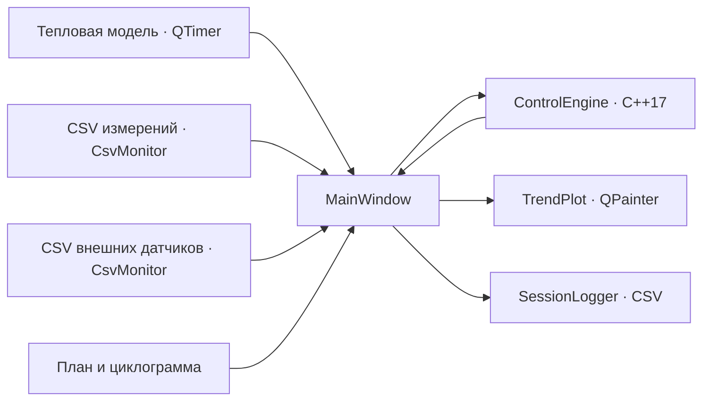

# Архитектура и алгоритм

## Поток данных



`ControlEngine` не зависит от Qt и источника измерений. `MainWindow` координирует ввод, расписание, расчёт, отображение и журналирование. Публичная версия не содержит аппаратного адаптера и не передаёт команды исполнительным устройствам.

Параметры фиксируются на время расчёта. Загрузка другого плана, переключение источника и сброс T₀ требуют остановки. Завершение циклограммы оставляет PI активным. Остановка отменяет расписание, выключает цикл и сбрасывает интегратор и рассчитанный выход.

`ExperimentPlan::load` сначала формирует проверенный временный результат: неудачная загрузка не разрушает предыдущий эксперимент.

## PI и ограничение выхода

Для измерения T и интервала dt:

```text
error = target - T
integral += error × dt
PI = Kp × error + Ki × integral + bias
demand = PI + FF_E + FF_R
maxPower = voltage × current
power = clamp(demand, 0, maxPower)
code = round(power / maxPower × codeMax)
```

Это общее линейное представление команды, без преобразования в физические импульсы. `codeMax` задаётся пользователем в пределах 1–65535; в демонстрационном примере используется 1000.

Если интегрирование усиливает насыщение, шаг интегратора отменяется; если помогает выйти из насыщения, сохраняется. При Ki = 0 интегратор сбрасывается. На первом измерении после старта dt = 0. Некорректные числа отклоняются.

Квантование отключено по умолчанию. Для иллюстрации разрешения используется условный диапазон 0–100 °C и выбранное число бит; это не калибровка прибора.

## Feed-forward

Для каждого канала хранится отдельная пара предыдущих значений. Дискретизация lead-lag:

```text
alpha = tauDen / (tauDen + dt)
beta1 = K × (tauNum + dt) / (tauDen + dt)
beta0 = K × tauNum / (tauDen + dt)
output = alpha × previousOutput + beta1 × input - beta0 × previousInput
```

Вход E — отрицательная мощность возмущения из активной циклограммы, в ваттах. Вход R — `T₀_R − T_R`, если захвачено T₀ и доступны свежие данные. В деморежиме внешние температуры моделируются, в CSV-режиме читаются из отдельного журнала. Плановые значения мощности R используются только демомоделью.

## Время и память

Для dt и графиков используется монотонный `QElapsedTimer`. Календарное время применяется для выбора старта и подписей журналов. Расписание преобразуется в однократную задержку; последующая корректировка часов не переносит уже поставленный таймер.

Графики хранят последние 600 секунд, максимум 20 000 точек на ряд. По умолчанию показываются последние 120 секунд. Значения осей рассчитываются по видимым данным; постоянный сигнал не увеличивает диапазон оси при каждом обновлении. Виджет использует QPainter и не содержит заимствованного кода библиотеки графиков.

Журнал событий интерфейса ограничен 100 строками. CSV-монитор читает заголовок и не более 64 KiB хвоста раз в 500 мс; незавершённые строки игнорируются. Одинаковая последняя строка не считается новым измерением. При отсутствии нового основного измерения более 5 секунд расчёт останавливается. Та же проверка действует для CSV внешних датчиков при включённой R-компенсации.

## Демомодель

```text
ambient = 16 °C
dT/dt = (heaterPower + disturbanceE + disturbanceR − 12 × (T − ambient)) / 240
```

Модель первого порядка обновляется каждые 250 мс с небольшим детерминированным шумом измерения. При 12 Вт установившаяся температура равна 17 °C. Kp = 80 и Ki = 2 выбраны для этой демонстрационной модели; она не описывает исследовавшийся физический объект.
